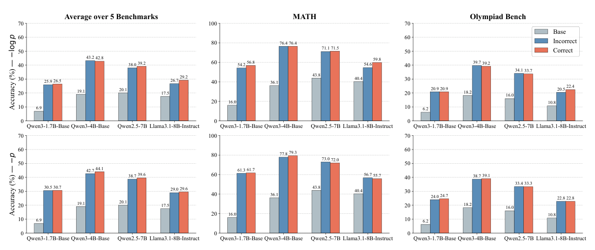
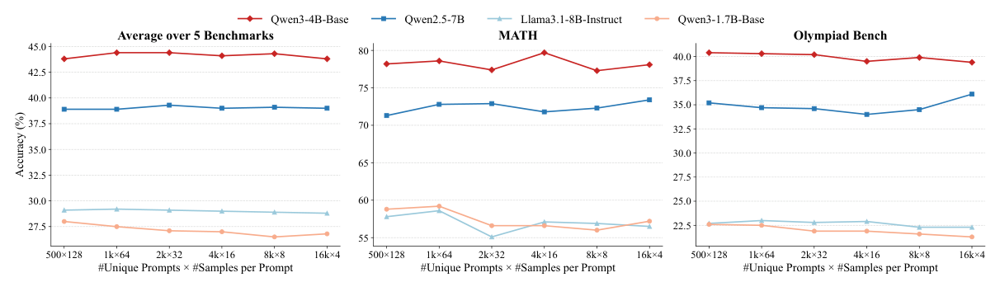
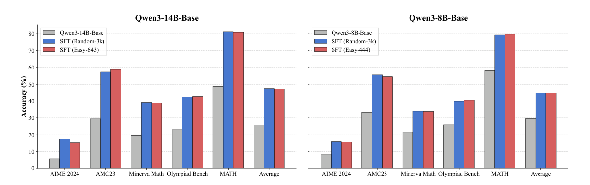
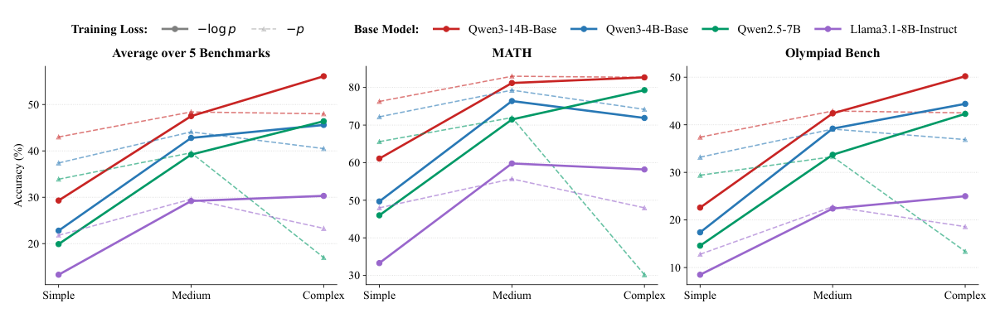

<h1 align="center">Facts Don’t Speak Louder than Words:<br>The Behavioral Essence of Long-CoT Distillation</h1>

<p align="center"><i>NeurIPS 2026 · Code and representative experiments</i></p>

<p align="center">
  <a href="#overview">Overview</a> ·
  <a href="#data-preparation">Data Preparation</a> ·
  <a href="#key-findings">Key Findings</a> ·
  <a href="#repository-contents">Repository Contents</a> ·
  <a href="#getting-started">Getting Started</a> ·
  <a href="#datasets">Datasets</a> ·
  <a href="#citation">Citation</a>
</p>

<p align="center">
  
  
</p>

---

## Overview

Long chain-of-thought (Long-CoT) distillation is usually trained on *correct* reasoning traces collected from *diverse* problems. What actually drives the gains? Our experiments suggest that models primarily acquire **reusable reasoning behaviors**—organizing existing knowledge into structured, step-by-step solutions—rather than simply memorizing problem-specific facts. We call this the **Behavioral Hypothesis**.

This repository provides training code, selected experiment configurations, a mathematical evaluation harness, and the evaluation questions. The large training trajectories are **not included in GitHub**; see [Data Preparation](#data-preparation) for how to download them. The figures and results below come from the paper, not new runs of this repository.

---

## Data Preparation

A GitHub clone already includes the five math evaluation benchmarks—**AIME 2024, AMC23, Minerva Math, OlympiadBench, and MATH (2,000 problems)**—plus four generation-prompt sets in [`math_evaluation/data/`](math_evaluation/data/). No additional data download is needed to evaluate a local model.

For training, download the seven Parquet trajectory files from the [Long-CoT-Distillation dataset on Hugging Face](https://huggingface.co/datasets/yuyongcan/Long-CoT-Distillation). From a fresh checkout, keep the dataset's `verl/data/` directory structure:

```bash
git clone https://github.com/yuyongcan/Long-CoT-Distillation.git
cd Long-CoT-Distillation
python -m pip install "huggingface_hub[cli]" pyarrow
hf download yuyongcan/Long-CoT-Distillation --repo-type dataset --include 'verl/data/**' --local-dir .
python verl/train_configs/verify_data.py
```

The verifier checks the seven downloaded training files and the nine evaluation/prompt files already tracked in Git against [`data_manifest.json`](verl/train_configs/data_manifest.json). If the dataset is private, sign in with `hf auth login` first. The training files remain excluded from Git commits by [`.gitignore`](.gitignore).

---

## Key Findings

### 1. Incorrect answers can still teach reasoning behavior

Across the paper's mathematical comparisons, training on teacher trajectories with **incorrect final answers** retains **97.7% of the accuracy** and **94.7% of the improvement over base models** achieved with correct trajectories (Figure 1). When correct examples are scarce, incorrect trajectories can help: starting with 512 correct examples, adding incorrect examples at a 1:5 positive-to-negative ratio increases average accuracy from **20.4% to 26.4%** (Figure 2).

<p align="center">
  
</p>

> **Figure 1.** Final-answer errors do not necessarily erase useful reasoning structure. The negative set contains teacher-generated trajectories selected by final-answer correctness; this does **not** mean arbitrary, logically broken traces are helpful.

### 2. Broad prompt coverage is not the bottleneck under a fixed trajectory budget

Sampling 128 candidate responses from each of **500 prompts** performs comparably to sampling 4 from each of **16,000 prompts** (Figure 3). For Qwen3-1.7B-Base, the average across five math benchmarks is **28.0% vs. 26.8%** at these endpoints (paper Table 9). After correctness filtering, the released training files contain **450 vs. 10,729 distinct prompts**, respectively.

<p align="center">
  
</p>

> **Figure 3.** Increasing the number of unique training prompts has little effect in this controlled setting.

### 3. Already-solvable problems still improve reasoning

Fine-tuning on problems the base model solved in at least **7 of 8** attempts yields substantial improvements comparable to training on randomly selected problems (Figure 4). The paper studies **Easy-444** with Qwen3-8B-Base and **Easy-643** with Qwen3-14B-Base; this repository includes the Easy-444 comparison. The finding supports the Behavioral Hypothesis but does not prove a parameter-level separation of behavior and knowledge.

<p align="center">
  
</p>

> **Figure 4.** Improving on already-solvable questions is consistent with learning *how to reason* using existing knowledge.

### 4. Match the SFT loss to CoT complexity

The preferred objective changes with reasoning depth (Figure 5). For **Qwen3-4B-Base**, paper Table 8 reports the following `avg@16` accuracies, averaged equally across five math benchmarks:

| Training CoT | Mean trajectory length | `-log p` | `-p` |
|:---|---:|---:|---:|
| Simple | 426 tokens | 22.8% | **37.4%** |
| Medium | 1,337 tokens | 42.8% | **44.1%** |
| Complex | 9,062 tokens | **45.6%** | 40.5% |

<p align="center">
  
</p>

> **Figure 5.** Probability-based `-p` excels on simpler traces, while cross-entropy `-log p` scales better to complex, long reasoning. The paper discusses different weights on low-probability tokens as a possible explanation, not a universal rule.

These are **paper results**, not measurements re-run here. The provided experiments cover representative conditions only: Figure 3's two endpoints, Figure 4's Easy-444 comparison, and Qwen3-4B-Base for Figure 5. Figure 2's mixture study, some models, and non-math evaluations are not included.

---

## Repository Contents

| Path | Contents |
|:---|:---|
| [`verl/verl/`](verl/verl/) | Full-parameter SFT trainers for `-log p` and `-p`. |
| [`verl/train_configs/`](verl/train_configs/) | 14 representative experiment settings, training launcher, and data checksum manifest. |
| [`math_evaluation/`](math_evaluation/) | Math evaluator and the [`sh/run_eval.py`](math_evaluation/sh/run_eval.py) launcher. |
| [`math_evaluation/data/`](math_evaluation/data/) | **Tracked in GitHub:** five math benchmark test sets and four prompt subsets (9 JSONL files). |
| `verl/data/` | **Not tracked in GitHub:** seven training Parquet files (approximately 595 MiB locally). |
| [`assets/`](assets/) | Figures extracted from the paper. |

No model weights or trained checkpoints are distributed here.

---

## Getting Started

### Evaluate a local model

The five math test sets are included in a normal GitHub clone; **training data is not required to run evaluation**. Use a compatible Python 3.10 environment with an NVIDIA GPU, vLLM, and a local Hugging Face-format model:

```bash
git clone https://github.com/yuyongcan/Long-CoT-Distillation.git
cd Long-CoT-Distillation
python -m pip install -r math_evaluation/requirements.txt
python -m pip install --no-build-isolation -e math_evaluation/latex2sympy
python math_evaluation/sh/run_eval.py --model-path /path/to/local/HF-model --dry-run
python math_evaluation/sh/run_eval.py --model-path /path/to/local/HF-model
```

Evaluation uses AIME 2024, AMC23, Minerva Math, OlympiadBench, and MATH-2000, with 16 samples per problem at temperature 1.0. The reported `avg@16` is the mean of sample accuracies, then averaged equally over the five benchmarks. Results are saved under the Git-ignored `math_evaluation/outputs/`. When evaluating a checkpoint created by the launcher below, use `--experiment fig1_correct_ce` instead of `--model-path`.

### Train a representative experiment

**Training requires the seven Parquet files** at the `verl/data/` paths specified by [`data_manifest.json`](verl/train_configs/data_manifest.json); they are not included in a GitHub clone. Use Python 3.10, a CUDA-compatible PyTorch installation, and the dependencies in `verl/requirements.txt`. The paper used 8 NVIDIA A100-80G GPUs; 32k-token runs require substantial host memory.

After completing [Data Preparation](#data-preparation), inspect the configurations and launch an experiment:

```bash
python verl/train_configs/verify_data.py
python verl/train_configs/train.py --list
python verl/train_configs/train.py --experiment fig1_correct_ce --model-path /path/to/Qwen3-1.7B-Base --dry-run
python verl/train_configs/train.py --experiment fig1_correct_ce --model-path /path/to/Qwen3-1.7B-Base
python math_evaluation/sh/run_eval.py --experiment fig1_correct_ce
```

| Paper comparison | Experiment names | Base model |
|:---|:---|:---|
| Figure 1 · correct vs. incorrect, both losses | `fig1_correct_ce`, `fig1_incorrect_ce`, `fig1_correct_p`, `fig1_incorrect_p` | Qwen3-1.7B-Base |
| Figure 3 · 500 vs. 16k source prompts | `fig3_diversity_500`, `fig3_diversity_16k` | Qwen3-1.7B-Base |
| Figure 4 · already solvable vs. random | `fig4_easy_444`, `fig4_random_3k` | Qwen3-8B-Base |
| Figure 5 · simple, medium, complex × both losses | `fig5_simple_ce`, `fig5_simple_p`, `fig5_medium_ce`, `fig5_medium_p`, `fig5_complex_ce`, `fig5_complex_p` | Qwen3-4B-Base |

The launcher writes checkpoints under the Git-ignored `verl/checkpoints/` and refuses to overwrite an existing run. The `-p` trainer uses probability-weighted NLL to implement the `-p` gradient.

**Reproduction notes:** The bundled MATH-2000 set is a new seed-42 draw, not the exact 2,000 IDs evaluated in the paper; numerical results may differ. The Simple-CoT config uses 1 epoch to reflect its original run setting, whereas the paper states 3 epochs as the general default.

---

## Datasets

### Mathematical evaluation data (included)

| Test set | Questions | File |
|:---|---:|:---|
| AIME 2024 | 30 | [`aime24/test.jsonl`](math_evaluation/data/aime24/test.jsonl) |
| AMC23 | 40 | [`amc23/test.jsonl`](math_evaluation/data/amc23/test.jsonl) |
| Minerva Math | 272 | [`minerva_math/test.jsonl`](math_evaluation/data/minerva_math/test.jsonl) |
| OlympiadBench | 675 | [`olympiadbench/test.jsonl`](math_evaluation/data/olympiadbench/test.jsonl) |
| MATH (seed-42 subset) | 2,000 | [`math/test.jsonl`](math_evaluation/data/math/test.jsonl) |

Four additional prompt sets are included under [`math_evaluation/data/`](math_evaluation/data/): random-3k (2,995), diversity-500 (500), diversity-16k (16,000), and Easy-444 (444). These prompt sets support data generation and analysis; the evaluator runs the **five test sets** above by default.

### Training trajectories (separate release)

The seven training Parquet files are **excluded from GitHub** and available from the [Long-CoT-Distillation dataset on Hugging Face](https://huggingface.co/datasets/yuyongcan/Long-CoT-Distillation); follow [Data Preparation](#data-preparation) to download them into `verl/data/`. Their relative paths, row counts, and SHA-256 checksums are in [`verl/train_configs/data_manifest.json`](verl/train_configs/data_manifest.json). The 22,222 correct trajectories are reused for the random-problem and medium-CoT baselines rather than duplicated. The incorrect set has 25,778 trajectories; the Easy-444 set contains 26,445 trajectories.

---

## License and Acknowledgments

The repository's code is distributed under [Apache License 2.0](LICENSE). The included `verl` components retain their [license](verl/LICENSE) and [notice](verl/Notice.txt); the math evaluator and bundled `latex2sympy` parser retain their respective [MIT licenses](math_evaluation/LICENSE) and [license notices](math_evaluation/latex2sympy/LICENSE.txt). The evaluation questions and training data originate from the cited datasets and benchmarks in the paper; the code license does not supersede any upstream data terms.

## Citation

```bibtex
@inproceedings{yu2026facts,
  title     = {Facts Don't Speak Louder than Words: The Behavioral Essence of Long-CoT Distillation},
  author    = {Yongcan Yu and Jian Liang and Lingxiao He and Kuangpu Guo and Yanbo Wang and Shuo Lu and Meng Wang and Ran He},
  booktitle = {Advances in Neural Information Processing Systems},
  year      = {2026}
}
```
